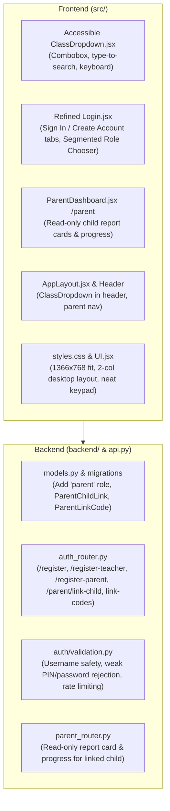

# Login & Authentication Polish Analysis

**Date:** 2026-11-20  
**Branch:** `login-polish`  
**Author:** Senior Full-Stack Engineer & Product Designer  

---

## 1. Existing Sections and Tabs on the Login Page

Currently, [src/pages/Login.jsx](file:///m:/AI%20Internsip%20projects/parivestra%20ai%20tutor/src/pages/Login.jsx) contains:

| Section / Tab | Description & Functionality |
|---|---|
| **Student Login (`mode === "student"`)** | • **Step 1:** Big 8-tile visual grid of Class 3 to Class 10 with mascot previews (`GradeGrid.jsx`). • **Step 2:** Username text field + Secret input.   - Junior (Classes 3–5): 4-digit PIN indicator dots + on-screen 0–9 numeric keypad.   - Middle/Senior (Classes 6–10): Standard password field with show/hide toggle. • Submit button: "Start Learning (Class X)". • Quick demo buttons (`kid3`, `kid4`, `student6`). |
| **Teacher / Grown-ups (`mode === "teacher"`)** | • Single adult login form: email or username + password. • Submit button: "Open Grown-ups Portal". • Quick demo fill button (`ms_sharma` / `teach123`). |
| **Join Class (`mode === "join"`)** | • Self-enrollment via 6-character class code (e.g., `PARI-4A`) + optional student nickname. • Creates an unauthenticated guest/student linked to that class. |
| **Guest Mode Link** | • Secondary link below student form: *"⚡ Or explore instantly as a Guest Explorer (No login needed)"*. • Generates an ephemeral guest user (`guest_xxxxxxxx`) without password. |
| **Parent Tab** | ⚠️ **Does not exist yet.** Grown-ups area currently serves only teachers and parents using the admin math challenge or teacher login. |

---

## 2. How Each Role Registers Today

| Role | Current Registration Flow |
|---|---|
| **Student** | • Can be created **only** by a teacher/admin via `POST /api/auth/teacher/students` or `POST /api/auth/teacher/students/bulk` in Grown-ups, or via class code (`POST /api/auth/join-class`). • There is **no public self-registration form** for students today. |
| **Teacher** | • Seeded via `scripts/seed_demo_accounts.py` or created directly in DB. • There is **no public teacher registration endpoint** or invite-code validation. |
| **Admin** | • Seeded via `scripts/create_admin.py` or authenticated via `ADMIN_KEY` (`X-Admin-Key` header). • No public sign-up (security best practice). |
| **Parent** | • **Non-existent.** No registration endpoint, no parent table, no parent session. |

---

## 3. Which Roles Exist in the Backend Today

In [backend/models.py](file:///m:/AI%20Internsip projects/parivestra ai tutor/backend/models.py#L75) and [backend/routes/auth_router.py](file:///m:/AI%20Internsip projects/parivestra ai tutor/backend/routes/auth_router.py#L188):
- Current roles in `User.role`:
  1. `student`
  2. `teacher`
  3. `admin`
- `parent` is **not** currently a recognized role in the database or authorization checks.

---

## 4. What the Parent Role Can Currently See

- Currently, parents have **no distinct portal or login**.
- If parents visit `/grown-ups`, they encounter the general Grown-ups gate (which has a simple math challenge `7 + 8 = 15` or 4-digit PIN), which opens the full administrative dashboard (review queue, class management, LLM health, AI draft generation).
- This violates privacy and child-safety principles: parents should **only** see their linked children's read-only academic records (report cards, progress, workbook units, certificates) without seeing other students, editing classes, approving drafts, or accessing chat history.

---

## 5. Implementation Plan

### File-by-File Modification Plan

#### 1. Backend Configuration & Models
- `backend/config/__init__.py`: Add `TEACHER_INVITE_CODE`, `DEMO_MODE`, `ALLOW_SELF_SIGNUP`, `REQUIRE_CLASS_CODE`.
- `backend/models.py`:
  - Add `ParentChildLink` model (`parent_id`, `child_id`, `created_at`).
  - Add `ParentLinkCode` model (`id`, `code`, `student_id`, `teacher_id`, `expires_at`, `used`, `used_by_parent_id`).
  - Update `User.role` documentation and relationships (`parent_links`, `child_links`).
- `backend/database.py`: Add automatic SQLite schema updates for `parent_child_links` and `parent_link_codes`.

#### 2. Validation & Security Primitives
- `backend/auth/validation.py` (New):
  - Username validation: 3–20 chars, regex `^[a-zA-Z0-9_-]+$`, case-insensitive uniqueness, profanity blocklist, anti-PII check (rejects emails, phone numbers, full names with spaces).
  - PIN strength check: reject `1234`, `0000`, `1111`, sequential or repeated digits.
  - Password strength check: minimum 8 characters, letters and numbers.
  - Per-IP rate limiting tracker for registration endpoints.

#### 3. Backend Routes
- `backend/routes/auth_router.py`:
  - `POST /api/auth/register` (student self-registration with auto-login session).
  - `POST /api/auth/register-teacher` (validates `TEACHER_INVITE_CODE`).
  - `POST /api/auth/register-parent`.
  - `POST /api/parent/link-child` (verifies 7-day link code and associates child).
  - `GET /api/parent/children` (returns only linked children and their active grades).
  - `GET /api/auth/username-available` (fast rate-limited check).
  - `POST /api/teacher/link-codes` (teacher generates single-use 7-day link code for a student).
  - Prevent role escalation: reject any registration payload trying to pass `role: "admin"` or `role: "teacher"`.
- `api.py`:
  - Mount parent-specific scoped report card / progress endpoints verifying parent-child link.

#### 4. Frontend Components
- `src/components/ClassDropdown.jsx` (New):
  - Accessible ARIA combobox with arrow key navigation, Enter/Space selection, type-to-search, screen reader labels.
  - Color dot indicator for grade theme, edition subtitle ("Class 4 · AI Builders").
  - Replaces `GradeGrid.jsx` on Login page, Sign-up form, and topbar header switcher.
- `src/pages/Login.jsx`:
  - Fit 1366x768 without scrolling.
  - Tabs: "Sign in" vs "Create account".
  - Segmented control: Student, Teacher, Parent.
  - Compact, neat keypad for PIN (Junior).
  - 2-column layout on wide screens (Pari & welcome left, card right), 1-column on mobile.
  - Demo accounts shown only if `DEMO_MODE=true`.
- `src/pages/ParentDashboard.jsx` (New):
  - Read-only view for linked children.
  - "Link Child" modal (child username + link code).
  - Tabs/Selector for multiple children.
  - Displays report card, unit completion, certificates, progress summary.
- `src/components/AppLayout.jsx`:
  - Replace Grade modal trigger with `ClassDropdown`.
  - Add "Parent Portal" nav item for `role === "parent"`.
- `src/api/client.js`:
  - Add client methods for register, link child, teacher link code generation, check username.

#### 5. Tests
- `tests/test_login_polish.py` (New):
  - Student, teacher, parent registration.
  - Teacher invite code rejection.
  - Weak PIN / password rejection.
  - Role escalation prevention.
  - Parent linking & access control verification (parent cannot read unlinked student data).
  - Persistence across sessions.
